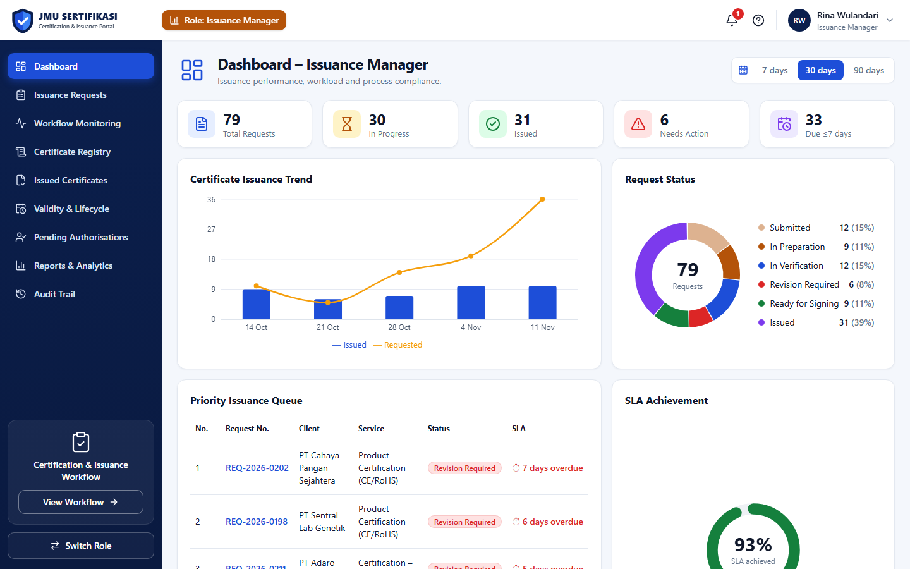

# JMU Certification & Issuance Portal (demo)

A working demo of a certificate issuance workflow: an officer prepares a document, a verifier checks it, an authorised signatory signs it, and the issued certificate gets a public QR verification page. Five roles, a manager dashboard, an audit trail, user onboarding and certificate lifecycle (suspend / reinstate / revoke) — all backed by a real REST API and a SQLite database seeded with sample data.



## Requirements

- **Node.js 20 or newer** (and npm, which comes with it)
- Nothing else: no Docker, no database server, no API keys, no `.env` to fill in.

## Run

```bash
npm install
npm run dev
```

Then open <http://localhost:3000>.

- The **first** `npm run dev` creates and seeds the SQLite database (`prisma/dev.db`) before starting. Expect roughly 30–40 seconds. Later starts are fast.
- Pages compile on first visit in dev mode, so the first click on each screen takes a moment.
- On the login page pick a role, then a person. There are no passwords in the demo.

| Role | Demo user |
| --- | --- |
| Issuance Officer | Andi Pratama |
| Document Verifier | Dewi Lestari |
| Authorised Signatory | Budi Santoso |
| Issuance Manager | Rina Wulandari |
| System Administrator | Fajar Hidayat |

A pending registration ("Dwi Ananda") is seeded for the onboarding demo.

### Reset the sample data

```bash
npm run db:reset
```

Restores the seeded data (and clears uploaded files). It is safe to run while the dev server is running.

## Demo walkthrough

Use a separate browser window (or a private window) per role, or use **Switch Role** in the sidebar between steps.

### 1. Main journey: request to a verified certificate

1. **Officer (Andi)** → *Issuance Requests* → **Create Issuance Request**: client *PT Surya Kencana Industri*, service scope *Certification – ISO 9001*, priority *High* → **Create Request**.
2. Select the new request → **Prepare Document**. Fill in client address, certified sites and audit date (leave the address short on purpose). Click **Save & Send to Verification**.
3. **Verifier (Dewi)** → *Verification Queue* → open the draft → **Return for Revision** with a comment such as "Client address incomplete".
4. **Officer (Andi)** → *Draft Documents*: the draft is now *Revision*, **v1.1**; the comment is under *Revision History*. **Edit Draft**, fix the address, **Save & Send to Verification**.
5. **Verifier (Dewi)** → open the draft again → *Checklist* tab → tick every item → **Approve**.
6. **Signatory (Budi)** → *Signing Queue* → open the document → **Sign Document** → confirm. The success dialog shows the new certificate number (`JMU-QMS-<year>-…`).
7. **Officer (Andi)** → *Issued Certificates*: the certificate is **Active**. **Download Certificate** gives a PDF with a QR code.
8. Open `http://localhost:3000/verify/<certificate number>` in a window with no login (this is what the QR code points to): it shows **Active**.
9. **Manager (Rina)** → *Dashboard*: the **Issued** count went up by one.
10. **Manager (Rina)** or **Admin (Fajar)** → *Audit Trail*: search the draft number to see every step, in order, with who did it.

### 2. Reject path

Repeat steps 1–5 above, then as **Signatory (Budi)** click **Reject** and give a reason. The request returns to *In Preparation*; the officer sees the rejected document and can **Prepare Document** again to start a new draft.

### 3. Onboarding path

1. Logged out, open <http://localhost:3000/register/1>. Choose a role → *Continue to Role Review* → *Proceed to Registration & Authorisation*.
2. Fill in the form, upload the 7 required documents (any PDF/PNG will do), tick the declaration, **Submit for Authorisation**.
3. **Manager (Rina)** → *Pending Authorisations* → select the registration → **Approve**. (The seeded "Dwi Ananda" registration can be used for this too.)
4. The new person now appears on the login page under their role and can sign in.

### 4. Lifecycle

**Manager (Rina)** → *Issued Certificates* → select a certificate → *Lifecycle* tab → **Suspend** with a reason. Open the certificate's `/verify/<number>` page: it now shows **Suspended**. **Reinstate** reverses it.

## Architecture

```
 Browser UI  ──►  src/api-client  ──►  app/api/**  (REST, thin)
 (app/**, src/components)  + src/contract types        │
                                                       ▼
                                      src/services   (use cases: permission check,
                                                       │ workflow transition, audit log,
                                                       │ all in one DB transaction)
                                                       ▼
                         src/domain (pure rules)   src/repositories (Prisma)
```

| Layer | Where | What lives there |
| --- | --- | --- |
| Domain | `src/domain/*` | Framework-free rules: workflow state machine, permissions per role, numbering, validity dates, SLA, checklist, navigation. Covered by `tests/domain`. |
| Services | `src/services/*` | Every state change: (1) permission check, (2) workflow transition check, (3) audit-log row, in one transaction. Take an `Actor` (user, role, assignment). |
| Repositories | `src/repositories/*` | Prisma client, DB URL handling, number sequences. |
| REST API | `app/api/**`, `src/server/*` | Thin route handlers: session, Zod validation (`src/server/schemas.ts`), error mapping. Contract: `docs/api/openapi.yaml`. |
| Client | `src/api-client/*`, `src/contract/*` | Typed `fetch` wrapper, React Query hooks and the DTO types shared with the server. |
| UI | `app/**`, `src/components/**` | Screens. They only talk to the API. |

**The import rule** (enforced by ESLint `no-restricted-imports`, so `npm run lint` fails on a violation): UI code (`app/**`, `src/components/**`, `src/api-client/**`) must not import `@/services/*`, `@/repositories/*`, `@/server/*` or `@prisma/client`. UI gets data only through `src/api-client` and types only from `src/contract`. There are no Next.js server actions: every change is a REST call.

Error responses always look like `{ "error": { "code", "message" } }` (`FORBIDDEN` 403, `NOT_FOUND` 404, `VALIDATION` 400, `INVALID_TRANSITION` / `CONFLICT` 409, `UNAUTHENTICATED` 401).

## Testing

```bash
npm test                              # unit + service + API tests (vitest)
npx playwright install chromium       # once, to download the browser for e2e
npm run test:e2e                      # full browser suite; npm run test:e2e -- journey runs the main journey only
npm run lint
npm run build                         # production build
```

- The e2e suite starts **its own** dev server on port 3100 with its own build folder (`.next-e2e`), database (`prisma/e2e.db`) and files (`storage-e2e`), so it does not disturb your own `npm run dev` on port 3000 and can run beside it.
- If e2e behaves strangely (stale compile output), stop it, delete the `.next-e2e` folder and run again.

## Moving to production

This is a demo; these are the pieces to replace.

### Database: SQLite → PostgreSQL

The schema is Postgres-compatible by design (enums are strings validated by Zod/domain types, JSON is stored as text).

1. `prisma/schema.prisma`: set the datasource `provider = "postgresql"`.
2. Set `DATABASE_URL` to your Postgres connection string (Prisma 7 reads it via `prisma.config.ts`; `.env` is loaded automatically).
3. Swap the driver adapter: `src/repositories/prisma.ts` uses `@prisma/adapter-libsql`; use `@prisma/adapter-pg` there instead, and adjust `src/repositories/db-url.ts` (it normalises SQLite file paths) and the scripts in `scripts/` if you keep them.
4. The existing migrations are SQLite SQL: generate a fresh Postgres baseline (`node node_modules/prisma/build/index.js migrate dev`), then deploy with `node node_modules/prisma/build/index.js migrate deploy`.

**`overrides` in `package.json`.** It pins `@libsql/client` to `0.18.0`. With `0.17.4` (what the libsql adapter resolves on its own) every transaction leaked a native connection and the app crashed under load. Remove the override once `@prisma/adapter-libsql` accepts `^0.18` — and it is irrelevant after moving to Postgres.

### Authentication

Demo login is *pick a user*, no password. Replace `src/server/session.ts` (session cookie) and the login page (`app/login`, `src/components/login`) with your identity provider (SSO / OIDC / passwords). The services already take an `Actor` (`userId`, `role`, `assignmentStatus`, `scopeCodes`), so nothing below the API changes. Set a real `SESSION_SECRET` (32+ characters) while you still use the cookie session; without it a built-in demo secret is used.

### File storage

Uploaded registration documents are written to local disk (`storage/`, override with `STORAGE_DIR`) via `src/services/storage.ts`. Replace that one module with S3 / Azure Blob / etc.

### Public base URL

Certificate QR codes and verification links use the **request origin** by default (`http://localhost:3000` in the demo). Set `PUBLIC_BASE_URL` (for example `https://certs.example.com`) so they always point at your public address; it is used by the PDF route and the certificate panel. It is read at build time for the UI, so set it before `npm run build`.

### Replacing the backend (Python, Go, …)

The UI only depends on the REST contract:

1. Implement `docs/api/openapi.yaml` in your stack (same paths, JSON shapes, error shape and status codes).
2. Point the UI at it: set `NEXT_PUBLIC_API_BASE_URL` (for example `https://api.example.com`). The default is empty = same origin. `src/api-client/client.ts` reads it.
3. Cross-origin caveat: the session is a cookie. Calls use `credentials: 'include'`, so the API must send CORS headers with `Access-Control-Allow-Credentials: true` and a specific origin, and set the cookie with `SameSite=None; Secure` (or serve the API on the same site, e.g. behind a reverse proxy at `/api`). The root `proxy.ts` guard reads the demo cookie, so replace it with your own check too.
4. Port the rules in `src/domain/*` (workflow, permissions, numbering, validity, SLA). They are framework-free and `tests/domain` documents the expected behaviour — translate those tests first.

## Troubleshooting

- **Folder name has spaces or `&`**: supported. All npm scripts call Node entry files directly instead of `.bin` shims.
- **Port 3000 in use**: `npm run dev -- --port 3001`.
- **Data looks wrong / want a clean slate**: `npm run db:reset`.
- **First start is slow**: it is creating and seeding the database (once) and `postinstall` generated the Prisma client during `npm install`.
- **Dates**: seeded dates are relative to the day you run the seed, so a `db:reset` refreshes them.
